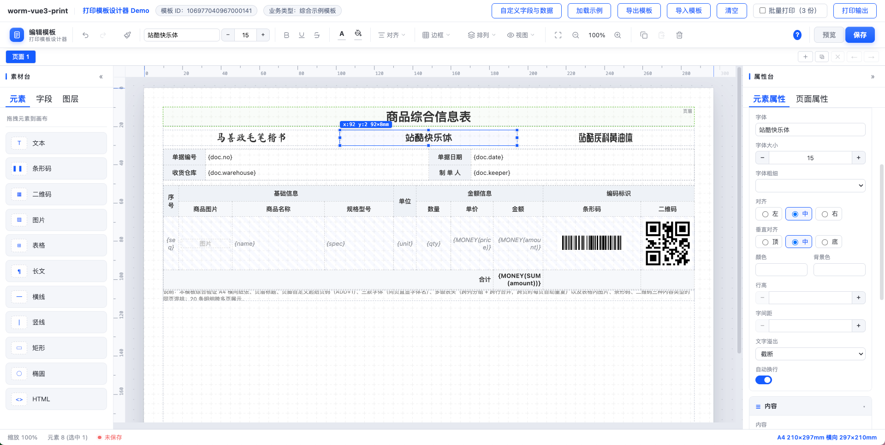

# worm-vue3-print

Vue 3 可视化打印模板设计器 + 模板表达式引擎 + 同构渲染管线的开源 monorepo（npm workspaces）。

可视化拖拽设计打印模板、数据绑定、表达式求值、分页排版；三端共用同一套渲染与分页算法（逻辑同源，像素级一致还需字体与 Chromium 内核同源）。
纯 Vue 3 + HTML/CSS/SVG 原生控件实现，不依赖任何 UI 组件库，可以接入任意 Vue 3 项目中。

> ⚠️ **实验性能力声明**：`packages/print-common`（`@worm-vue3-print/common`）与示例 `demo-common/` 属于**实验性质**，用于把设计器以零框架运行时形态（原生自定义元素）提供给 **Vue 3 / Vue 2 / React / jQuery 等多种运行时框架**（含无框架宿主）。该包**尚未完成稳定性测试**，已按**正式版本号**发布到 npm（dist-tag `latest`，当前 `1.4.7`，安装直接 `npm i @worm-vue3-print/common`），npm 主页面保留实验性声明并包含 Vue3 / Vue2 / React 用法示例；不建议用于生产，Vue 3 项目请使用成熟的 `@worm-vue3-print/canvas`。

## 🔗 在线预览

GitHub Pages：**https://worm-longliu.github.io/worm-vue3-print/**

> 静态部署，仅支持设计器编辑、浏览器预览与浏览器端打印；服务端 PDF 与桌面客户端静默打印不可用。

## 🖼 设计器预览



## 📖 文档

**[中文文档首页 · 文档总览](docs/中文/文档总览.md)** ｜ [快速开始](docs/中文/指南/快速开始.md) ｜ [API 文档](docs/中文/接口/API文档.md) ｜ [示例](docs/中文/示例/示例文档.md)

**English**: [Overview](docs/en/Overview.md) ｜ [Changelog](docs/en/CHANGELOG.en.md)（由 AI 依据中文文档生成，以中文版为准）

使用指南：

- [使用指南（核心概念与输出方式选型）](docs/中文/指南/使用指南.md)
- [模板设计器（PrintDesigner 接入）](docs/中文/指南/模板设计器.md)
- [表达式引擎（数据绑定与内置函数）](docs/中文/指南/表达式引擎.md)
- [渲染管线（浏览器预览 / 服务端 PDF）](docs/中文/指南/渲染管线.md)
- [三端渲染一致性方案](docs/中文/指南/三端渲染一致性方案.md)
- [静默打印（桌面客户端 + 浏览器 SDK）](docs/中文/指南/静默打印.md)
- [MCP 使用与集成（在自有项目/AI agent 里接入打印模板能力）](docs/中文/指南/MCP集成.md)
- [Skills 安装与使用（Vue 3 / common / MCP 协作技能）](skills/README.md)
- [技术复盘（偏差原因与客户端选型）](docs/技术复盘.md)
- [CHANGELOG（版本变更记录）](docs/中文/CHANGELOG.md)


## 项目目录结构

```
worm-vue3-print/
├── packages/                  # 工作区包（npm workspaces；core / canvas / common / skills 发布到 npm，contract 与 mcp 暂不发布）
│   ├── print-core/            # @worm-vue3-print/core   模板表达式引擎 + 同构渲染管线（含浏览器端静默打印 SDK 子路径 /client）
│   ├── print-canvas/          # @worm-vue3-print/canvas Vue 3 可视化设计器画布
│   ├── print-common/          # @worm-vue3-print/common 通用宿主适配版设计器（实验性 · 未完全稳定测试；支持多种运行时框架；生产请用 print-canvas）
│   ├── print-contract/        # @worm-vue3-print/contract 模板契约层：zod schema / 表达式校验 / 静态版面体检 / 草稿生成（private，不发布 npm）
│   ├── print-mcp/             # @worm-vue3-print/mcp     桌面客户端内部 MCP 工具库：5 个纯计算工具 + 4 个实时模板会话工具（private）
│   ├── print-skills/          # @worm-vue3-print/skills   使用技能的 npx/Git 安装器（Node.js >=20，无运行时依赖）
├── clients/
│   └── print-client/          # @worm-vue3-print/print-client Electron 静默打印桌面客户端（private，不发布 npm）
├── services/
│   └── print-render/          # @worm-vue3-print/render 服务端 PDF 渲染微服务（private，不发布 npm）
├── demo/                      # 演示项目：Vue 3 设计器 + 预览 + 静默打印集成的完整示例
├── demo-common/               # 演示项目（实验性 · 未完全稳定测试）：apps/ 下四个独立宿主 demo（Vue3/Vue2/React/jQuery），index.html 为静态导航页
├── docs/                      # 项目文档
│   ├── 中文/                  #   中文文档（指南 / 接口 / 示例 / 文档总览 / CHANGELOG）
│   ├── en/                    #   英文文档（首页 Overview / CHANGELOG，AI 生成并声明）
│   └── superpowers/           #   设计文档（specs）与实施计划（plans）
├── skills/                    # 三个可分发使用技能（Vue 3 / common / MCP）与 npx 安装说明
├── scripts/                   # 仓库级脚本（打印架构守卫、产物版权头注入）
├── .github/
│   ├── workflows/             # CI / 自动发布工作流
│   └── release/               # 发布配置
├── .opencode/                 # opencode 本地配置与插件
├── package.json               # npm workspaces 根清单：构建 / 测试 / 打包根命令
├── AGENTS.md                  # 对本仓库工作的 AI 代理约束（语言、分层边界、协作约定）
├── CONTRIBUTING.md            # 发布与协作流程
├── SECURITY.md                # 安全问题报告方式
├── LICENSE                    # MIT
└── README.md
```

各目录功能说明：

| 目录 / 文件 | 功能说明 |
|---|---|
| `packages/print-core` | 核心包（`@worm-vue3-print/core`）：表达式引擎（lexer / parser / evaluator）、`template-parser`、数据绑定 / 分页 / HTML 生成（`render`）、设计器内核与浏览器适配（`designer` / `browser`，含连续纸探针与 `browserCodeRenderer`）；浏览器端静默打印 SDK 位于子路径 `/client`（传输层 / 协议与错误码 / 打印门面）。纯 TypeScript，无 Vue、无宿主依赖 |
| `packages/print-canvas` | 设计器画布（`@worm-vue3-print/canvas`）：Vue 3 组件（`components`）、组合式函数（`composables`）、内置帮助内容（`help-content`）、原生控件样式（`styles`）。含 `PrintDesigner`、`PrintHtmlPreview` |
| `packages/print-common` | ⚠️ **实验性 · 未完全稳定测试**：通用宿主适配设计器（`@worm-vue3-print/common`）：以原生自定义元素 `<print-designer>` 形态提供，**支持多种运行时框架**——任意框架（Vue 3 / Vue 2 / React / jQuery / Angular 等）或无框架宿主均可直接接入，供 React / Vue2 / jQuery 等非 Vue3 宿主使用，**不打包 Vue 运行时**。样式与图标由 `scripts/gen-styles.mjs`、`scripts/gen-icons.mjs` 从 canvas 构建产物派生（类名逐字对齐），交互与渲染逻辑复用 core 的 designer 导出；另产出浏览器直挂形态 `dist/common.js`（UMD，core 与码制库内联，挂 `window.WormPrintCommon`）与 `dist/common.css`，无打包器宿主一个 `<script>` + 一个 `<link>` 即可接入。与 Vue3 版的功能与样式一致性说明见包内 `PARITY.md`，宿主示例在 `demo-common/apps/` |
| `packages/print-contract` | 模板契约层（`@worm-vue3-print/contract`，private）：把 `TemplateData`/`ElementOptions` 收敛为机器可读契约——`OPTION_META` 全键元数据（编译期必填映射，core 加字段而此处漏登记则 `tsc` 红）、zod schema 与 `validateTemplateJson`（废弃键/未知键只降级 warning，不判死存量模板）、`checkExpression`（语法交给 core 解析器、函数名走白名单）、`inspectTemplate`（静态版面体检，**不做排版测量**）、`draftTemplate`（走 core 元素工厂产草稿并回灌三道校验） |
| `packages/print-mcp` | 桌面客户端内部 MCP 工具库（`@worm-vue3-print/mcp`，private）：提供 5 个纯计算工具与 4 个模板会话工具，由客户端在本机 `/mcp` 组合暴露。**不调用模型、不读取任何模型密钥**，工具循环归宿主 AI Agent |
| `clients/print-client` | 静默打印桌面客户端（Electron，private）：主进程 WS 服务 / 打印引擎 / 打印机服务 / 配置与任务记录（`src/main`）、配置窗口 Vue 3 界面（`src/renderer`）、隐藏渲染 worker（`src/worker`）、沙箱 IPC 桥（`src/preload`）、IPC 通道契约（`src/shared`）；含 electron-builder 打包配置与真机冒烟脚本（`scripts/`） |
| `services/print-render` | 服务端渲染微服务（private）：基于 Playwright 的 PDF 渲染（`driver-playwright` / `pdf-render` / `browser-pool` / `server`），workspace 软链依赖 core，与浏览器预览、桌面客户端共用同一份打印管线 |
| `demo` | Vue 3 演示项目：设计器接入（`App.vue`）、静默打印集成、渲染客户端封装（`render-client.ts`）、业务字段（`business.ts`）、内置模板 JSON（`template-purchase-receipt.json`），端口 9303 |
| `demo-common` | ⚠️ **实验性示例 · 未完全稳定测试**（对应上方实验性的 `print-common`）：通用宿主适配、**支持多种运行时框架**的多宿主集成示例：`apps/vue3`（9331，SFC）、`apps/vue2`（9332，SFC + Options API）、`apps/react`（9335，hooks）走 **NPM 包接入**；`apps/jquery`（9334）走 **JS + CSS 直挂**（无打包器、业务代码不 import 插件，只用 `window.WormPrintCommon` + `$`）。四个工程彼此独立（各有 `package.json` / lock / node_modules），**不共用任何壳层封装**——设计器挂载、`fields`/`template` 的 property 注入、`uploadImage` 宿主回调、`save`/`preview`/`help`/`dblclick-element`/`dblclick-cell` 事件、浏览器渲染预览与打印、服务端 PDF、客户端静默打印、批量份数都写在各自的文件里，照抄一个工程即可落到自己项目；示例模板/字段/数据也各自带一份（`src/templates.js`）。四个页面的界面版式与 `demo/` **完全一致**：同一份顶栏动作、同一个全屏打印预览层、同一套「打印输出 / 加载示例 / 自定义字段与数据」弹窗，样式由 `scripts/sync-demo-styles.mjs`（`npm run styles:demo-common`）从 `demo/` 逐字抽取成各工程同 MD5 的 `src/styles/demo-ui.css`，工程内不再写私有布局样式。`index.html` 是四入口静态导航页，`scripts/dev-all.mjs` / `install-all.mjs` 一次拉起或安装四个工程，`scripts/verify-demo.mjs` 做 32 项 UI 级验收（按 demo 类名逐项判定，含防「DOM 全绿但布局塌陷」的尺寸断言） |
| `docs` | 文档：`中文/`（指南、接口、示例、文档总览、CHANGELOG，为权威版本）、`en/`（英文首页 Overview 与 CHANGELOG，由 AI 生成并在文内声明），`superpowers/` 为设计文档（specs）与实施计划（plans） |
| `skills` | 三个可分发使用技能：`worm-vue3-print-integration`（Vue 3）、`worm-vue3-print-common`（跨框架）、`worm-vue3-print-mcp`（MCP 与模板生成）；通过 `npx @worm-vue3-print/skills <技能名>` 安装，详见 `skills/README.md` |
| `scripts` | 仓库级 Node 脚本：`check-print-architecture.mjs`（三端重复实现守卫，`npm run lint:print-architecture`）、`inject-license-banner.mjs`（发布包类型声明补版权头） |
| `.github/workflows` | CI（构建 / 测试）与自动发布工作流 |
| `package.json` | 根清单：workspaces 聚合、构建 / 测试 / 打包根命令（`npm run pack:client` 等） |

## 包结构

| 包 | 目录 | 发布 | 说明 |
|----|------|------|------|
| `@worm-vue3-print/core` | `packages/print-core` | npm | 模板表达式引擎与同构渲染管线（数据绑定 / HTML 生成 / 分页，含连续纸探针推导），纯 TypeScript，无 Vue、无宿主依赖，浏览器与 Node 均可运行；浏览器端静默打印 SDK 经子路径 `@worm-vue3-print/core/client` 提供 |
| `@worm-vue3-print/canvas` | `packages/print-canvas` | npm | Vue 3 可视化设计器画布（原生控件，无 Element Plus；含 `PrintDesigner`、`PrintHtmlPreview` 组件） |
| `@worm-vue3-print/common` | `packages/print-common` | npm 正式版（`latest`）· **实验性** | ⚠️ 通用宿主适配设计器 `<print-designer>`（零框架运行时，实现为原生 Custom Element + Shadow DOM）：**支持多种运行时框架**，功能与样式对齐 `@worm-vue3-print/canvas`，供 React / Vue2 / jQuery 等非 Vue3 宿主接入（详见包内 `PARITY.md`）。**按正式版本号发布，安装直接 `npm i @worm-vue3-print/common`**；npm 主页面含 Vue 3 / Vue 2 / React 用法示例；**尚在实验阶段、未完全稳定测试，不建议用于生产**，Vue 3 项目请继续使用 `@worm-vue3-print/canvas`（成熟方案） |
| `@worm-vue3-print/skills` | `packages/print-skills` | npm | 三个使用技能的 npx/Git 安装器：显式技能名，支持 `--repo`、`--ref`、`--dir`、`--force`，默认安装到项目 `.agents/skills` |
| `@worm-vue3-print/render` | `services/print-render` | 内部 | 基于 Playwright（Headless Chromium）的服务端 PDF 渲染微服务，Docker 部署；与浏览器预览、桌面客户端共用同一份渲染管线，保证三端出纸一致 |
| `@worm-vue3-print/print-client` | `clients/print-client` | 内部 | 跨平台静默打印桌面客户端（Electron，回环 WebSocket + core 同构渲染 + `webContents.print` 静默出纸） |

> 发布到 npm 的正式包为 `core`、`canvas`、`common` 与 `skills`：core/canvas/skills 由 `npm run publish:npm` 按标签发布；`@worm-vue3-print/common` 与主线同号发布正式版（dist-tag `latest`，当前 `1.4.7`），但保留实验性声明，发布走 `npm run publish:common` 或手动触发 `publish-common.yml`（流程见 [CONTRIBUTING.md](CONTRIBUTING.md)）；`render` 与 `print-client` 为私有工作区包，分别以 Docker 镜像和安装包形式分发，客户端安装包挂在 [GitHub Releases](https://github.com/worm-longliu/worm-vue3-print/releases)（见下文[下载客户端安装包](#下载客户端安装包)）。示例 `demo-common` 不在工作区内，仍以 `file:` 依赖消费本仓库的 common；该包**尚未完成稳定性测试**，不建议应用到生产，Vue 3 项目请使用 `@worm-vue3-print/canvas`。

## 功能特性

- 可视化画布：拖拽、吸附、对齐、参考线、标尺、图层面板、多选与组合、撤销/重做
- 元素丰富：文本、长文本、数据表格、条形码、二维码、图片、线条、形状、HTML、页码、水印
- 数据绑定：`{field.path}` 字段绑定、表达式求值（safelist 安全执行）、格式化函数
- 智能表格：动态分页、跨页重复表头、序号/小计/汇总、单元格合并
- 同构渲染：一套渲染逻辑同时产出浏览器预览、服务端 PDF 与桌面客户端出图（逻辑同源）
- 静默打印：跨平台桌面打印客户端（Electron）+ 浏览器端 SDK，本地 WebSocket 通讯、`webContents.print` 静默出纸，全程无打印对话框、不依赖浏览器插件，支持连续纸纸长自动推导
- AI 辅助模板编辑：桌面客户端内置 MCP（`/mcp`，Bearer 鉴权），AI Agent 可校验模板、读写浏览器里正在编辑的模板（防覆盖 revision + 封禁元素拦截）；详见 [AI 接入](docs/中文/指南/AI接入.md)
- 内置业务模板：采购收货单、批发销售单、出入库单、库存盘点单
- 毫米（mm）单位精确布局，支持 A4 等纸张规格

## 🗺 待办（Roadmap）

- [x] 浏览器 ↔ 桌面客户端 ↔ AI Agent 实时画布 MCP：本机 HTTP 12 个工具，支持批量 Patch、精简读取、参考图测量与 revision 防覆盖写回
- [ ] 画布内 AI 面板与宿主能力探测（第二阶段；只出注入式 transport 接口规范，本仓库不实现服务端 key 代理）

## 开发

```bash
npm install      # 在仓库根安装并链接各 workspace 包
npm run build    # 构建所有包
npm test         # 运行所有包测试
```

各模块开发启动（均在仓库根执行）：

| 命令 | 作用 |
|---|---|
| `npm run dev:demo` | 启动 demo（Vite，http://localhost:9303） |
| `npm run dev:demo-common:vue3` | 启动 Vue3 宿主 demo（Vite，http://localhost:9331）；`…:vue2` / `…:react` / `…:jquery` 同理，端口 9332 / 9335 / 9334 |
| `npm run dev:demo-common:all` | 一次起四个宿主 demo（先 `npm run install:demo-common:all` 逐个安装依赖） |
| `npm run styles:demo-common` | 从 `demo/` 重新生成四个宿主工程的 `src/styles/demo-ui.css`（版式必须与 demo 一致，产物勿手改） |
| `npm run dev:render` | 启动渲染微服务（tsx 直跑，http://localhost:3001） |
| `npm run dev:client` | 启动 Electron 桌面客户端（electron-vite dev） |
| `npm run dev:core` | core 以 watch 模式持续构建 dist（tsup） |
| `npm run dev:canvas` | canvas 以 watch 模式持续构建 dist（vite build --watch，不含 vue-tsc 类型检查） |

> demo 与 Electron 客户端消费 core / canvas / SDK 的构建产物（dist），改库代码后可用
> `dev:core`、`dev:canvas` 自动重编译；类型检查仍需执行完整 `npm run build`。

## 安装

```bash
# 安装核心包（模板表达式引擎 + 同构渲染管线）
npm install @worm-vue3-print/core

# 安装设计器画布（Vue 3 可视化设计器 + 预览组件）
npm install @worm-vue3-print/canvas
```

静默打印浏览器端 SDK 随 core 提供，无需单独安装，从 `@worm-vue3-print/core/client` 导入（需配合本机运行的桌面打印客户端）。

> core / canvas 当前版本：`1.4.7`。

## 更新

```bash
# 检查可用更新
npm outdated

# 更新到最新版本
npm update @worm-vue3-print/core @worm-vue3-print/canvas

# 或直接安装最新版
npm install @worm-vue3-print/core@latest @worm-vue3-print/canvas@latest
```

其他包管理器：
- yarn: `yarn upgrade @worm-vue3-print/core @worm-vue3-print/canvas`
- pnpm: `pnpm update @worm-vue3-print/core @worm-vue3-print/canvas`

## 快速使用

### `@worm-vue3-print/core`（模板表达式引擎 + 同构渲染管线）

```ts
import { bindData, paginate, generateHtml } from '@worm-vue3-print/core'

const bound = bindData(templateJson, printData)      // 数据绑定
const pages = paginate(bound, measured, options)     // 分页排版
const html = generateHtml(pages)                     // 生成 HTML
```

### `@worm-vue3-print/canvas`（Vue 3 可视化设计器）

以下接入配置与仓库 `demo/App.vue` 保持一致：

```ts
import { PrintDesigner, PrintHtmlPreview, createDefaultTemplate } from '@worm-vue3-print/canvas'
import type { PrintBusinessField, TemplateData } from '@worm-vue3-print/canvas'
// 设计器控件样式（发布包唯一对外样式入口），需全局引入一次
import '@worm-vue3-print/canvas/style.css'
```

```vue
<template>
  <PrintDesigner
    ref="designerRef"
    :initial-template="templateData"
    :fields="fields"
    :is-edit="true"
    :show-help="true"
    @preview="onPreview"
    @save="onSave"
  />

  <!-- 「加载默认布局」等业务入口由宿主自渲染，不在设计器工具栏内 -->
  <button type="button" @click="onLoadDefaultLayout">加载默认布局</button>

  <!-- 浏览器端免保存预览：直接使用当前画布 JSON + 业务数据 -->
  <Teleport to="body">
    <PrintHtmlPreview
      v-if="previewVisible"
      ref="htmlPreviewRef"
      :template-json="previewTemplateJson"
      :print-data="printData"
      @rendered="(n) => previewPages = n"
    />
  </Teleport>
</template>

<script setup lang="ts">
import { ref } from 'vue'

const templateData = ref<TemplateData>(/* 初始模板 TemplateData */)
const fields = ref<PrintBusinessField[]>(/* 业务字段 PrintBusinessField[] */)
const designerRef = ref<InstanceType<typeof PrintDesigner> | null>(null)
const previewTemplateJson = ref<Record<string, any> | null>(null)

function onPreview() {
  // 获取当前画布模板 JSON，供免保存预览
  const json = designerRef.value?.getTemplateJson?.()
  if (!json) return
  previewTemplateJson.value = json
}

function onSave(json: string) {
  // 宿主持久化模板 JSON
}

/**
 * 加载默认布局：宿主自实现的业务逻辑。示例用 createDefaultTemplate() 造空白默认模板，
 * 真实宿主可在此按业务类型拉取服务端默认模板；用新对象回写 templateData 引用即可重载画布
 */
function onLoadDefaultLayout() {
  if (!confirm('将覆盖当前画布内容，是否继续？')) return
  templateData.value = createDefaultTemplate()
}
</script>
```

关键 props / 事件 / 方法：

- `initial-template`：初始模板 `TemplateData`；`fields`：业务字段 `PrintBusinessField[]`；
  `is-edit`：是否编辑态。
- `show-help`：帮助入口开关，默认开启，传 `false` 可关闭帮助按钮与帮助弹框。
- `@preview` / `@save`：预览与保存事件，宿主持有 `getTemplateJson()`/`getTemplateJson` 之外的业务逻辑自理。
- `getTemplateJson()`：通过 `ref` 获取当前画布模板 JSON，用于预览 / 保存。
- 模板加载 / 重置（如「加载默认布局」）属于宿主业务：把新的 `TemplateData` 赋给
  `initial-template` 即可重载画布并记录一次历史（撤销可回退），设计器工具栏不内置该入口。
- `PrintHtmlPreview`：同构预览组件，`template-json` 传画布模板 JSON，`print-data` 传业务数据，
  事件 `rendered` 回调预览页数，`ref.print()` 触发打印。

## MCP 安装与使用

MCP 能力只通过“浏览器设计器 ↔ 桌面客户端 ↔ AI Agent”链路提供，用于生成、校验和修改浏览器中正在编辑的模板。无需单独安装 `@worm-vue3-print/mcp`，它是桌面客户端的 private 内部工具库。

### 1. 开启桌面客户端

安装并打开[桌面客户端](#下载客户端安装包)，在设置页开启「AI 助手」，复制页面生成的 MCP 配置。默认配置示例如下，实际端口和 token 以设置页为准：

```json
{
  "mcpServers": {
    "worm-vue3-print": {
      "url": "http://127.0.0.1:17521/mcp",
      "headers": {
        "Authorization": "Bearer <设置页展示的配对 token>"
      }
    }
  }
}
```

将配置合并到 Claude Desktop、Cursor 或其他 MCP 客户端的 `mcpServers` 中，然后重启或重新连接该客户端。

### 2. 注册浏览器模板会话

宿主页面通过 `@worm-vue3-print/core/client` 连接桌面客户端，使用 `setRequestHandler` 处理 `template.get` / `template.apply`，并调用 `attachTemplate` 签到。`template.apply` 必须核对 `baseRevision`、校验模板并拦截封禁元素；页面卸载时调用 `detachTemplate` 并关闭连接。完整代码见 [MCP 使用与集成指南](docs/中文/指南/MCP集成.md) 和 [`demo/src/template-session.ts`](demo/src/template-session.ts)。

### 3. 让 AI 操作实时画布

桌面客户端提供 12 个工具：

- 模板能力：`print_element_kinds`、`print_draft_template`、`print_validate_template`、`print_check_expression`、`print_inspect_layout`。
- 视觉与测量：`print_preview_template`（渲染 PNG + 元素实际包围盒）、`print_analyze_reference_image`（设计稿转几何数据）、`print_compare_with_reference`（与参考图逐线比对）。
- 实时会话：`print_list_open_templates`、`print_get_open_template`、`print_patch_open_template`、`print_apply_open_template`。

推荐流程：列出会话 → 小改优先摘要读取并保存 revision → 用 `print_patch_open_template` 批量修改 → 以上次返回的 revision 继续链式 Patch。新模板或复杂重排再读取完整快照、校验、预览（有参考稿时逐线比对）并整份写回。发生 `REVISION_CONFLICT` 时重新读取，不能强制覆盖。真实分页与出纸效果通过设计器或打印预览确认。

## Skills 安装与使用

Skills 为宿主 AI Agent 提供项目集成和 MCP 协作流程，不是 MCP 服务本身。安装器要求 Node.js 20 或更高版本，每次必须且只能安装一个技能，默认安装到当前项目的 `.agents/skills/`：

```bash
# Vue 3 项目：canvas/core 集成、打印链路、宿主 MCP 实时画布
npx @worm-vue3-print/skills worm-vue3-print-integration

# 跨框架项目：Vue 2.7 / React / jQuery / 原生宿主与 common 集成
npx @worm-vue3-print/skills worm-vue3-print-common

# MCP 协作：桌面客户端实时画布模板生成、校验与写回
npx @worm-vue3-print/skills worm-vue3-print-mcp
```

指定技能父目录、Git 仓库、分支或 tag；目标已存在时默认拒绝覆盖，确认替换后再加 `--force`：

```bash
npx @worm-vue3-print/skills worm-vue3-print-mcp \
  --repo https://github.com/worm-longliu/worm-vue3-print.git \
  --ref v1.4.7 \
  --dir /path/to/project/.agents/skills \
  --force
```

安装后让宿主 Agent 重新加载技能，即可直接提出「在 Vue 3 项目接入打印设计器」「把 common 集成到 React 页面」或「通过 MCP 生成并校验打印模板」等任务。安装器只复制技能文件，**不会修改 MCP、Codex 或其他 Agent 配置**。完整参数与目录说明见 [Skills 安装说明](skills/README.md)。

## 静默打印（桌面客户端）

跨平台（Windows / Linux / macOS）静默打印由两部分组成：

- **桌面打印客户端**（`clients/print-client`，Electron）：部署在业务工位电脑上，在隐藏窗口内复用 `core/browser` 同构渲染模板，
  再调用 `webContents.print({ silent: true })` 直接出纸——无系统打印对话框、不依赖浏览器插件。
- **浏览器端 SDK**（core 子路径 `@worm-vue3-print/core/client`，无需单独安装）：浏览器页面通过 WebSocket（默认从 `127.0.0.1:17521` 起端口探测，占用则 +1）
  连接本机运行的客户端，完成端口探测 / 自动重连 / 打印机枚举 / 静默打印。

### 下载客户端安装包

安装包**不在 npm 发布，也不入仓库**，而是作为 GitHub 发行版（Releases）的附件提供：

> **[GitHub Releases 页面](https://github.com/worm-longliu/worm-vue3-print/releases)** —— 点击下载，无需登录。可下载的最新安装包来自 `v1.4.7`（正式版，Release 标记为 Prerelease=false）。

下表是 `v1.4.7` 发行版的客户端安装包完整直链，可直接点击或复制。**`v1.4.7` 是正式版**：本版重打了全平台安装包（含 MCP 视觉回验三个新工具与 Agent 接入提示词的桌面客户端）。

| 安装包直链 | 适用系统 |
| --- | --- |
| [https://github.com/worm-longliu/worm-vue3-print/releases/download/v1.4.7/WormPrintClient-1.4.7-mac-x64.dmg](https://github.com/worm-longliu/worm-vue3-print/releases/download/v1.4.7/WormPrintClient-1.4.7-mac-x64.dmg) | Intel Mac |
| [https://github.com/worm-longliu/worm-vue3-print/releases/download/v1.4.7/WormPrintClient-1.4.7-mac-arm64.dmg](https://github.com/worm-longliu/worm-vue3-print/releases/download/v1.4.7/WormPrintClient-1.4.7-mac-arm64.dmg) | Apple Silicon Mac |
| [https://github.com/worm-longliu/worm-vue3-print/releases/download/v1.4.7/WormPrintClient-1.4.7-win-x64.exe](https://github.com/worm-longliu/worm-vue3-print/releases/download/v1.4.7/WormPrintClient-1.4.7-win-x64.exe) | Windows 10 / 11 x64（NSIS 安装程序，可选择安装目录、创建桌面快捷方式） |
| [https://github.com/worm-longliu/worm-vue3-print/releases/download/v1.4.7/WormPrintClient-1.4.7-linux-amd64.deb](https://github.com/worm-longliu/worm-vue3-print/releases/download/v1.4.7/WormPrintClient-1.4.7-linux-amd64.deb) | Debian / Ubuntu x64（`sudo apt install ./<文件>`） |
| [https://github.com/worm-longliu/worm-vue3-print/releases/download/v1.4.7/WormPrintClient-1.4.7-linux-x86_64.rpm](https://github.com/worm-longliu/worm-vue3-print/releases/download/v1.4.7/WormPrintClient-1.4.7-linux-x86_64.rpm) | Fedora / RHEL / openSUSE x64（`sudo rpm -i <文件>`） |
| [https://github.com/worm-longliu/worm-vue3-print/releases/download/v1.4.7/WormPrintClient-1.4.7-linux-x86_64.AppImage](https://github.com/worm-longliu/worm-vue3-print/releases/download/v1.4.7/WormPrintClient-1.4.7-linux-x86_64.AppImage) | 任意 x64 发行版，免安装单文件（需 `libfuse2`） |
| [https://github.com/worm-longliu/worm-vue3-print/releases/download/v1.4.7/SHA256SUMS.txt](https://github.com/worm-longliu/worm-vue3-print/releases/download/v1.4.7/SHA256SUMS.txt) | 上述安装包的 SHA-256 校验和 |

下载不动或速度很慢时（GitHub 附件在国内直连常掉速，大文件容易中途断开）：

- 复制上表任意一条链接，粘贴到**迅雷**、IDM、qBittorrent 等支持断点续传的下载工具新建任务即可，安装包本身没有限制来源；用浏览器另存为时若提示失败，重试同一链接通常就能续上。
- 连 [Releases 页面](https://github.com/worm-longliu/worm-vue3-print/releases) 本身都打不开时，说明是 GitHub 访问受阻而非文件过大：换用可访问 GitHub 的网络或代理后重试，或直接按下一节[从源码构建客户端](#从源码构建客户端)自行打包（Gitee 侧的发行版只有源码包，没有安装包附件）。
- 下载工具有时会在文件名后追加 `(1)` 等重复标记，安装前核对一下文件名即可。
- 无论走哪条途径，装前都用 `SHA256SUMS.txt` 核对一次：校验和不一致说明文件不完整或被替换，请重新下载。

下载后可与安装包放在同一目录校验完整性（Linux 用 `sha256sum -c`）：

```bash
shasum -a 256 -c SHA256SUMS.txt
```

- **安装包未做 Developer ID 签名与公证**（本项目没有 Apple Developer ID 与 Windows 签名证书），首次打开会被系统拦截：macOS 执行 `xattr -dr com.apple.quarantine /Applications/WormPrintClient.app`，或在 系统设置 → 隐私与安全性 点「仍要打开」；Windows 在 SmartScreen 提示「未知发布者」页点「更多信息」→「仍要运行」。
- **Linux 三个包在 x64 的 Docker 容器内交叉构建，未经 Linux 真机安装与出纸验证**（出纸依赖 CUPS）。deb/rpm 内的 `chrome-sandbox` 为非 setuid（`0755`），启动若报 `SUID sandbox helper` 错误，需启用非特权用户命名空间或临时加 `--no-sandbox`；只提供 fuse3 的发行版（如 Ubuntu 24.04）跑 AppImage 前先装 `libfuse2`，或用 `--appimage-extract-and-run`。本版不提供 `snap` 与 Linux arm64 包。
- 发行版里同批出现的 `*.zip` 与 `*.blockmap` 是自动更新用的中间产物，客户端未接自动更新，**请下载 `.dmg` / `.exe` / `.deb` / `.rpm` / `.AppImage`**。
- **Gitee 用户请前往上面的 GitHub 地址下载**：Gitee 发行版附件单文件上限 100MB，超过该体积的安装包只能挂在 GitHub。

### 从源码构建客户端

客户端是 monorepo 内的私有工作区包（不发布 npm），产物为绿色目录或安装包，需在工位电脑安装并运行：

```bash
# 手工打包正式发行包（macOS + Windows）：构建安装包、生成 SHA256SUMS.txt，并打印上传命令
npm run pack:client:release

# 构建 macOS + Windows 安装包（macOS 可同时交叉打包 Windows）
npm run pack:client

# 只构建 macOS 安装包（Intel + Apple Silicon）
npm run pack:client:mac

# 只构建 Windows 安装包（x64 NSIS；可在 macOS 上交叉构建）
npm run pack:client:win

# Linux 安装包（deb / rpm / AppImage）：推荐在 Docker Linux 容器内构建
npm run pack:client:linux

# Linux 原生构建（仅在已安装 rpmbuild 等工具链的 Linux 主机上使用）
npm run pack:client:linux:native

# 绿色目录版（免安装，默认只产出当前系统的目录）
npm run pack:client:dir
```

> `pack:client:mac` / `pack:client:win` 会先构建 core、contract、mcp 和客户端产物。macOS 包需在 macOS 上构建；Windows 可在 macOS 交叉构建，也可在 Windows 上构建。
>
> Linux 推荐使用 `npm run pack:client:linux`：本机需安装并启动 Docker（Linux 容器），首次会拉取 `node:22-bookworm` 镜像并在容器内安装 `rpm`，耗时较长；镜像可用 `WORM_LINUX_BUILDER_IMAGE` 覆盖，网络受限时可设置 `ELECTRON_MIRROR`、`ELECTRON_BUILDER_BINARIES_MIRROR`、`APT_MIRROR`。如果直接在原生 Linux 环境打包，需先安装 Node.js 与 `rpm`/`rpmbuild`（以及 electron-builder 所需的 Linux 打包工具），再执行 `npm ci && npm run build`，或直接运行 `npm run pack:client:linux:native`。
>
> `npm run pack:client:release` 只覆盖 macOS + Windows；Linux 发行包需先执行 `npm run pack:client:linux`（或原生 Linux 构建），再执行 `node scripts/pack-client-release.mjs` 重新汇总校验和与上传命令。

### 宿主侧接入（浏览器端 SDK）

```ts
import { PrintClient, WormPrintError } from '@worm-vue3-print/core/client'

const client = new PrintClient()
client.onStatusChange((s) => console.log('客户端状态：', s)) // 'disconnected' | 'connecting' | 'connected'

await client.connect()                        // 自动探测端口并握手；客户端未运行抛 CLIENT_NOT_RUNNING
const printers = await client.listPrinters()  // 枚举本机打印机

// 连续纸（CONTINUOUS）模板无需传纸高，客户端按渲染内容自动推导；长度单位均为微米（1mm = 1000μm）
const { jobId } = await client.print(templateJson, printData, {
  printerName: printers[0]?.name,
  copies: 1,
})

client.pair(token)                            // 安全配对：客户端开启「安全开关」后，用配置窗口展示的 token 配对一次
```

- 断线自动指数退避重连；失败抛 `WormPrintError`，按 `err.code` 分支处理（`PRINTER_NOT_FOUND`、`BUSY`、`PRINT_FAILED` 等）。
- SDK 完整接口见 [静默打印指南](docs/中文/指南/静默打印.md)；
  客户端原理、协议与打包见 [`clients/print-client/README.md`](clients/print-client/README.md)。

## 渲染服务

服务端渲染位于本仓库 monorepo 的 `services/print-render`（私有服务包，不发布 npm）：
基于 Playwright 提供服务端 PDF 渲染微服务（`/render/pdf`），
通过 workspace 本地软链依赖 `core` 渲染管线，与浏览器预览、桌面客户端共用同一份实现；测量、连续纸探针、码制渲染与出图由 core 的 DOM 执行器在页面上下文执行。

```bash
# 本地开发（首次需 npx playwright install chromium，macOS 可直接使用系统 Chrome）
npm run dev:render

# Docker 构建（在仓库根执行）
docker build -f services/print-render/Dockerfile -t worm-vue3-print-render .
```

详见 [`services/print-render/README.md`](services/print-render/README.md)。

## 开源

- License：MIT（见 `LICENSE`）。
- 清晰的分层边界：`core`（纯逻辑）→ `canvas`（设计器 UI）。
- 发布与协作流程见 `CONTRIBUTING.md`。

## 依赖与开源协议（商用合规说明）

本项目采用 **MIT 协议**，商用、二次分发、闭源集成、修改后对外提供服务、二次销售均**无需授权申请、无需付费、无需开源你的业务代码**，唯一义务是保留本项目版权声明（`Copyright (c) 2026 worm <liu_long_qqcom@qq.com>`）。

### 运行时依赖清单与协议

以下是会被打进发布产物或随服务分发的**运行时依赖**，逐一经审计：

| 依赖 | 协议 | 所在模块 | 用途 | 商用影响 |
| --- | --- | --- | --- | --- |
| `jsbarcode` | MIT | core / canvas | 一维条码渲染 | 无限制 |
| `qrcode` | MIT | core / canvas | 二维码渲染 | 无限制 |
| `dompurify` | MPL-2.0 **或** Apache-2.0（双许可，可选） | canvas | HTML 富文本 XSS 净化 | 无限制 |
| `lucide-vue-next` | ISC | canvas | 工具栏图标 | 无限制 |
| `express` | MIT | render 服务 | HTTP 接口层 | 无限制 |
| `playwright` | Apache-2.0 | render 服务 | Headless Chromium 输出 PDF | 无限制 |
| `ws` | MIT | 桌面客户端 | 本地 WebSocket 静默打印通道 | 无限制 |

### 审计结论

- **不含任何 GPL / AGPL / LGPL / SSPL / CPAL 等强 copyleft 协议**，不存在「因依赖传染而被迫开源你自有代码」的风险。
- 唯一的弱 copyleft 来源是 `dompurify` 的 MPL-2.0 分支。MPL 只约束该库自身的源文件，且它同时授予 Apache-2.0 选项——**按 Apache-2.0 使用即可，本项目按 Apache-2.0 口径处理**，无任何附加义务。
- 开发期依赖（Vite、TypeScript、Vitest、vue-tsc 等，含 Electron 构建链）为 MIT / Apache-2.0 / BSD-3-Clause，**不进入发布产物、不随你的应用分发**，不构成下游义务。
- `playwright` 下载的 Chromium 二进制为 BSD-style 许可，可自由用于商业用途（含售卖生成的 PDF）；如需随 Docker 镜像分发，保留其声明文件即可。
- 依赖树共 545 个包（含 dev）已逐包核对 `license` 字段，无缺失声明、无 `NONE`/`SEE LICENSE IN` 之类不透明条目。

### 你需要做什么

**什么都不用做。** 若你把本库作为依赖集成进产品，且产品需要列出第三方许可清单（OSS Notice），可直接引用上表；本项目自身的 `LICENSE` 文件建议随产物一并保留。

> 本说明基于对项目依赖的静态审计，随版本更新维护。协议原文以各依赖官方仓库与 `LICENSE` 文件为准；本文不构成法律意见，重大商业决策请咨询法务。

## 仓库地址

- Gitee：https://gitee.com/liulong_oschina/worm-vue3-print
- GitHub：https://github.com/worm-longliu/worm-vue3-print

## 抖音 & 赞赏

本项目基于 MIT 协议免费开源，赞赏纯属自愿、与授权和服务无关。

如果这套工具帮到了你，欢迎扫码请作者喝杯咖啡；赞赏后请在 [Issue](https://github.com/worm-longliu/worm-vue3-print/issues) 留言昵称，我会登记进 [赞赏名单](SPONSORS.md)（仅公开昵称与日期，金额私有不公示）。

<p align="center">
  
  &nbsp;&nbsp;&nbsp;&nbsp;
  
  &nbsp;&nbsp;&nbsp;&nbsp;
  
</p>
